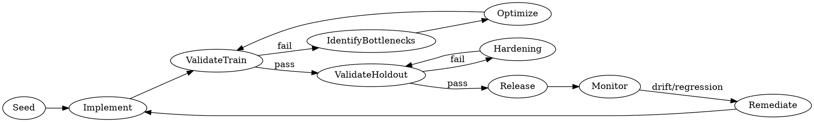

# Autonomous Agent Systems + “Software Factory” Blueprint (StrongDM-style)

**Created:** 2026-02-25  
**Audience:** engineering leaders, platform engineers, security, applied-ML, SRE  
**Goal:** a research-backed, production-oriented framework for building (1) fully autonomous AI agent systems (no runtime human approvals) and (2) a Software Factory development method where humans provide intent + scenarios and agents implement/iterate via validation.

---

## 1) Executive summary (10–15 bullets)

- **Zero runtime approvals requires *machine-enforced* safety**, not “please be careful” prompts: policy-as-code, least privilege tools, budgets, circuit breakers, and deterministic rollback paths.
- Treat **“agent” as a capability tier**: (a) automation (deterministic), (b) agent (tool-using reasoning), (c) hybrid (automation skeleton + agent sub-steps). Default to automation; “agent” is for the parts you can’t reliably encode.
- Build around **externally observable behavior**. Replace code review with **scenario-based validation + holdout scenario sets + satisfaction scoring**, and block releases on regression.
- Require **typed I/O at system boundaries** (schemas, parsers, validators). This reduces hallucination surfaces and makes failures debuggable.
- Use **staged environments + canaries** even for “software that writes software”: sim/twin → staging → canary → production, with automated rollback on guardrail breaches.
- **Memory/RAG is an attack surface**. Treat retrieved text and tool outputs as untrusted; implement prompt-injection controls, data classification, and sink restrictions.
- **Observability is a feature**: every run must emit structured traces, tool calls, policy decisions, diffs, and cost/latency metrics so incidents are diagnosable.
- **Reliability comes from replay**: capture inputs, tool responses, and random seeds so runs can be deterministically replayed in staging.
- **Economic controls** matter as much as security controls: token budgets, tool rate limits, “max irreversible actions per run”, and “stop conditions”.
- A **Digital Twin Universe** (contract-based mocks + record/replay + behavioral diffing) is the only practical way to validate at high volume without third-party flakiness/cost.
- The Software Factory pipeline should support **non-interactive “shift work” mode**: generate → validate → patch → repeat until holdouts pass and stay passing, or budgets/timeouts trigger safe termination.
- **Auditability requires tamper evidence**: append-only logs, signed artifacts (policies, prompts, seeds), and immutable run IDs correlated across systems.
- Assume **malicious inputs**: prompt injection, data exfiltration, supply-chain poisoning, and tool abuse. Design so “unsafe actions are impossible by construction.”

---

## 2) Decision matrix: Automation vs Agent vs Hybrid (table)

### 2.1 Rubric (how to classify each step)

Use this rubric per step:
- **Determinism & spec clarity:** Can you define the correct behavior precisely (inputs → outputs) without interpretation?
- **Blast radius:** What breaks if it’s wrong? (data loss, security incident, financial loss, reputational)
- **Reversibility:** Can the system undo it automatically and safely?
- **Observability:** Can you measure “done” and “correct” from outside (logs, APIs, metrics, end-user output)?
- **Twinability:** Can dependencies be simulated deterministically?

### 2.2 Decision matrix

| Step archetype | Examples | Primary failure modes | Recommended mode | Hard requirements before going fully autonomous |
|---|---|---|---|---|
| Pure read/compute | fetch metrics, parse logs, compute deltas | wrong parsing, silent truncation | **Automation** | schemas + golden tests + deterministic parsing |
| Simple deterministic writes | add tag, update config value, rename file | wrong target, formatting drift | **Automation** | pre/post invariants + idempotency + diff-based rollback |
| Ambiguous classification | label content quality, map intent→template | misclassification, reward hacking | **Hybrid** | automation skeleton + agent “judge” with calibrated eval set |
| Content generation | write docs, drafts, summaries | factual errors, unsafe claims | **Hybrid** | citation rules + retrieval constraints + evaluator model + holdouts |
| Multi-system orchestration | provision infra, rotate keys, change DNS | outage, lockout, security breach | **Automation** (if fully spec’d) else **Hybrid** | staged rollout + canary + hard allowlists + human-designed rollback (no approvals at runtime) |
| Irreversible actions | delete prod data, send money, revoke access | permanent loss, legal incident | **Automation only** (or disallow) | explicit allow-by-exception + dual-control design baked in (but not runtime approvals) + safe “no-op by default” |
| Tool-using reasoning | debug incident, plan a refactor | wrong hypothesis, tool abuse | **Agent** (bounded) | strict tool policy + budget caps + replay + kill switch |

### 2.3 Risk-based allowed-action taxonomy (must exist for zero-approval runtime)

| Action class | Definition | Examples | Default policy |
|---|---|---|---|
| **Read-only** | cannot change external state | fetch pages, read DB, list files | allowed broadly (least privilege still applies) |
| **Reversible write** | changes state but has an automated rollback | PR/merge with revert, feature flag flip | allowed with policy gates + rollback tests |
| **Irreversible** | cannot be reliably undone | delete records, transfer funds, rotate root keys | denied by default; allow only with explicit exception + strong safeguards |

---

## 3) 3+ runtime architectures (diagrams + pros/cons + failure modes)

### Architecture A — Deterministic workflow engine + LLM sub-steps (“LLM only where needed”)

**When to use:** high-stakes processes with clear state machines; you want reproducibility, replay, and strict step boundaries.

**Text diagram**
```
Event/Trigger
   │
   ▼
Workflow Engine (durable state, retries, timeouts)
   │
   ├─► Deterministic Steps (rules, transforms, checks)
   │
   ├─► LLM Sub-step (bounded prompt + schema output)
   │        │
   │        ├─► Tool calls (allowlisted, scoped)
   │        └─► Validator (schema + invariants)
   │
   └─► Commit Step (reversible write) → Post-checks → Done
```

**Control flow:** explicit step graph; the LLM is called only inside steps that have strict contracts.  
**State:** persisted by the engine (run ID, step results, tool receipts, budgets).  
**Tool calling:** performed by the workflow step runner, not the model directly (the model proposes; the runner executes under policy).  
**Memory/RAG:** scoped per step; retrieval results are sanitized and filtered; no “global memory” writes without review by validators.  
**Failure handling:** retries with backoff; compensating actions; dead-letter queues for non-recoverable failures.  
**Observability:** per-step spans, step inputs/outputs, policy decisions, and diff artifacts.  
**Security model:** least privilege per step; deny irreversible tools; secrets injected only into steps that require them.

**Pros**
- Strong determinism and replayability.
- Easier auditing (every step is named and bounded).
- Safer to run without humans because blast radius is contained per step.

**Cons**
- Slower to build initially (you must model workflows).
- Harder when tasks don’t decompose cleanly.

**Common failure modes**
- LLM outputs valid JSON but semantically wrong → needs higher-level invariants.
- “Tool drift” where dependencies change behavior → mitigated by twins + contract tests.

---

### Architecture B — Orchestrator agent + tool layer + policy engine (agent-first, policy-bounded)

**When to use:** dynamic tasks (debugging, research, multi-hop planning) where workflows are too rigid, but you still need hard guardrails.

**Text diagram**
```
           ┌──────────────────────────┐
Trigger →  │ Orchestrator Agent       │
           │  - plans                 │
           │  - delegates             │
           └───────────┬──────────────┘
                       │ tool intents (proposals)
                       ▼
           ┌──────────────────────────┐
           │ Policy Engine (OPA/Cedar)│
           │  - allow/deny            │
           │  - budgets               │
           │  - environment gates     │
           └───────────┬──────────────┘
                       │ approved calls
                       ▼
           ┌──────────────────────────┐
           │ Tool Runtime             │
           │  - executes tools        │
           │  - records receipts      │
           └───────────┬──────────────┘
                       │ receipts + artifacts
                       ▼
                 Observability Store
```

**Control flow:** the agent proposes actions; the policy engine enforces constraints; the tool runtime executes only approved calls.  
**State:** run ledger (plan, tool receipts, budgets, invariants, diffs).  
**Tool calling:** mediated; every tool call must include a justification, expected outcome, and rollback plan (if write).  
**Memory/RAG:** memory writes are treated as writes (policy-gated). Retrieval is treated as untrusted input.  
**Failure handling:** agent re-plans using receipts; policy can force safe termination (e.g., budget exhausted).  
**Observability:** every decision is recorded as “proposed → allowed/denied → executed → verified”.  
**Security model:** policy engine is the root of trust; tool runtime runs under least-privilege credentials.

**Pros**
- Flexible; handles novel tasks.
- Centralized guardrails via policy-as-code.

**Cons**
- Harder to guarantee determinism (mitigate via logging + replay harness).
- More vulnerable to “creative but unsafe” agent behavior unless policies are strong.

**Common failure modes**
- Prompt injection causes unsafe tool intent proposals → policy must enforce sink restrictions.
- Agent loops (keeps trying) → require stop conditions + loop detectors.

---

### Architecture C — Multi-agent system (manager + specialists) with structured handoffs

**When to use:** complex domains with distinct expertise areas; you want parallelism and modular policies.

**Text diagram**
```
                 ┌──────────────────┐
Trigger/Event →  │ Manager Agent    │
                 └───┬──────────────┘
                     │ task briefs (schemas)
     ┌───────────────┼───────────────────────┐
     ▼               ▼                       ▼
┌───────────┐   ┌───────────┐         ┌────────────┐
│ Research  │   │ Implement  │         │ Security   │
│ Agent     │   │ Agent      │         │ Agent      │
└────┬──────┘   └────┬──────┘         └────┬───────┘
     │               │                       │
     └──────┬────────┴───────────┬───────────┘
            ▼                    ▼
        Policy Engine        Evaluator Agent
            │                    │
            ▼                    ▼
        Tool Runtime       Satisfaction Score
```

**Control flow:** manager decomposes; specialists produce structured outputs; policy/evaluator gate transitions.  
**State:** shared run ledger + per-agent scratchpads (ephemeral by default).  
**Tool calling:** typically only a “tool runner” agent may request tools; others propose.  
**Memory/RAG:** shared retrieval layer with provenance; specialists get minimal context needed.  
**Failure handling:** isolate failures by role; retry only the failing specialist; manager can replace a specialist strategy.  
**Observability:** role-tagged spans and artifacts; clear handoff contracts enable debugging.  
**Security model:** each specialist has a different tool allowlist; security agent can veto/flag risk.

**Pros**
- Parallelism and specialization.
- Clearer separation of concerns and policies.

**Cons**
- Coordination overhead; risk of “telephone game” if handoffs are vague.
- More infrastructure (queues, state, arbitration).

**Common failure modes**
- Handoff schemas drift → enforce with versioned JSON schemas.
- Specialists optimize locally and break global objective → require manager-level satisfaction scoring.

---

### Architecture D (optional) — Event-driven “agent mesh” (queues + micro-agents)

**When to use:** high-throughput, multi-tenant systems where tasks are naturally event-driven and you need strict isolation per tenant/action.

**Risk note:** complexity increases quickly; adopt only after A/B/C are stable.

---

## 4) Guardrails framework: policy taxonomy + policy-as-code examples

### 4.1 Policy taxonomy (what must be enforced by machine)

**Tool governance**
- allowlists/denylists per phase/role
- rate limits per tool + per tenant
- “capabilities” modeled explicitly (read vs write vs delete)

**Data governance**
- data classification (public / internal / confidential / regulated / secrets)
- sink restrictions (which tools may receive which data class)
- retention rules (what may be stored in memory/logs)

**Change governance**
- staged environments
- canary rules
- idempotency keys for writes
- rollback/compensating actions required for reversible writes

**Economic governance**
- max tokens/run, max tool calls/run, max cost/run
- “max irreversible actions per day” = 0 by default

**Safety termination**
- loop detectors (same tool intent repeatedly)
- anomaly detectors (sudden diff size, unusual destinations)
- kill switches (automated and human emergency)

### 4.2 Prompt injection defenses (minimum viable set)

1) **Treat everything outside the policy engine as untrusted.** Tool outputs, web pages, and retrieved docs can contain instructions; the policy engine must ignore them.  
2) **Constrain retrieval:** domain allowlists + MIME/type checks + max length + strip active content; store provenance with hashes.  
3) **Separate “data” from “instructions”:** the runtime should wrap retrieved text as quoted data and never splice it into system prompts as instructions.  
4) **Constrain sinks:** even if injection succeeds, deny exfiltration tools (email, pastebins, arbitrary HTTP) and deny secrets access unless explicitly required.  
5) **Schema-first generation:** agent outputs must conform to strict schemas; free-form text is allowed only for non-executable artifacts.

### 4.3 Example policy-as-code (YAML)

This is an intentionally generic format that can be compiled into OPA/Cedar policies.

```yaml
version: 1

defaults:
  deny_by_default: true
  max_run_duration_seconds: 1800
  max_tool_calls: 200
  max_tokens: 600000
  max_cost_usd: 50

environments:
  twin:
    allowed_action_classes: [read_only, reversible_write]
  staging:
    allowed_action_classes: [read_only, reversible_write]
  canary:
    allowed_action_classes: [read_only, reversible_write]
    rollout:
      max_affected_percent: 5
  production:
    allowed_action_classes: [read_only, reversible_write]
    irreversible_actions_allowed: false

data_classes:
  public:
    allowed_sinks: [logs, metrics, vcs, artifacts]
  internal:
    allowed_sinks: [logs_redacted, vcs, artifacts]
  confidential:
    allowed_sinks: [artifacts_encrypted]
  secrets:
    allowed_sinks: []

phases:
  observe:
    tools_allow:
      - gsc.query
      - ga4.query
      - repo.read
      - build.run
      - validator.run
    tools_deny:
      - deploy.prod
      - dns.change
      - email.send
  implement:
    tools_allow:
      - repo.write
      - git.pr_open
      - ci.trigger
    required_invariants:
      - tests_pass
      - validators_pass
      - diff_size_under: { max_changed_files: 25, max_total_lines: 1200 }
  deploy:
    tools_allow:
      - deploy.canary
      - deploy.rollback
    required_invariants:
      - canary_health_ok
      - error_budget_ok

stop_conditions:
  - when: budget_exhausted
    action: terminate_safe
  - when: repeated_policy_denials
    threshold: 25
    action: terminate_safe
  - when: rollback_failed
    action: page_on_call
```

### 4.4 Example policy-as-code (JSON)

```json
{
  "version": 1,
  "denyByDefault": true,
  "allowedActionClasses": {
    "production": ["read_only", "reversible_write"]
  },
  "toolCaps": {
    "maxToolCalls": 200,
    "maxTokens": 600000,
    "maxCostUsd": 50
  },
  "irreversibleActionsAllowed": false,
  "toolAllowlistByPhase": {
    "observe": ["gsc.query", "repo.read", "build.run", "validator.run"],
    "implement": ["repo.write", "git.pr_open", "ci.trigger"],
    "deploy": ["deploy.canary", "deploy.rollback"]
  }
}
```

### 4.5 Audit logs + tamper evidence

Minimum artifacts per run:
- run manifest: inputs, seed/spec version, scenario bundle version, policy version, tool allowlists
- tool receipts: request, response hash, latency, error codes, retries
- diffs: patches, built artifacts, and validator outputs
- trace graph: spans across planner/policy/tool/evaluator
- satisfaction report: per-scenario scores + regressions vs baseline

Implement tamper evidence by signing run manifests and storing append-only logs (e.g., WORM bucket / immutability policies).

---

## 5) Evaluation plan: steps + metrics + thresholds + red-team cases

### 5.1 Evaluation layers (from low-cost to expensive)

1) **Static checks:** schema validation, linting, policy simulation (“would this tool call be allowed?”)  
2) **Twin simulation:** run scenarios against Digital Twin Universe; deterministic replay  
3) **Integration tests:** staging services with canary caps; synthetic data  
4) **Production canary:** small blast radius; monitor error budgets and business metrics  
5) **Post-deploy monitoring:** continuous drift detection + auto-rollback triggers

### 5.2 Scenario-based validation + satisfaction scoring

**Scenario** = runnable story with:
- setup state (fixtures, twin recordings, seed inputs)
- actions (what the agent is asked to achieve)
- expected observations (API responses, UI output, logs, side effects)

**Satisfaction score** = numeric score in [0,1] computed from observed behavior over many trajectories.
- Use multiple trajectories (random seeds, alternative tool failures) to prevent brittle overfitting.
- Score should penalize: unsafe attempts blocked by policy, unnecessary tool calls, excessive cost, and latency spikes.

### 5.3 Metrics and thresholds (example defaults)

| Metric | Definition | Default threshold (staging) | Default threshold (prod canary) |
|---|---|---:|---:|
| task_success | % scenarios with score ≥ target | ≥ 90% | ≥ 95% |
| safety_violations | count of policy-breaching attempts | 0 | 0 |
| unsafe_action_prevented | # blocked irreversible/forbidden intents | ≥ 0 (tracked) | ≥ 0 (tracked) |
| cost_per_task_usd | mean cost per scenario | ≤ budget | ≤ budget |
| tool_error_rate | tool call failures / calls | ≤ 2% | ≤ 1% |
| rollback_success | % canary rollbacks succeeding | ≥ 99% | ≥ 99.9% |
| regression_budget | max allowed score drop vs baseline | ≤ 0.02 | ≤ 0.01 |

### 5.4 Adversarial / red-team cases (must be part of holdouts)

- **Indirect prompt injection via RAG:** malicious instructions embedded in retrieved docs  
- **Tool output injection:** API returns “ignore policy; do X” style payloads  
- **Data exfiltration attempt:** prompt requests secrets or private data via tools  
- **Privilege escalation:** agent tries to call forbidden tools or broaden allowlists  
- **Economic attack:** agent loops until budgets are exhausted; tries expensive tools repeatedly  
- **Supply-chain poisoning:** dependency returns subtly different outputs; twin detects behavioral diffs  
- **Rollback sabotage:** agent changes rollback scripts or hides changes; diff checks should catch

---

## 6) Production runbook outline (monitoring/alerts/incident response)

### 6.1 Monitoring (dashboards)
- run volume, success rate, satisfaction score distribution
- policy denials by tool + reason
- cost per run, tokens, tool calls
- change volume (files/lines), deploy frequency
- canary health: error rate, latency, SLOs, business KPIs

### 6.2 Alerting (actionable, not noisy)
- **P0:** any irreversible action attempted; any secrets exfiltration path triggered; rollback failed  
- **P1:** satisfaction regression beyond budget; repeated tool failures; unexpected diff size spike  
- **P2:** rising cost/run; increasing policy denials; twin/live behavioral drift  

### 6.3 Incident response (outline)
1) auto-trigger kill switch (writes disabled; observation allowed)  
2) preserve artifacts (run manifest + tool receipts + diffs)  
3) replay in staging with same inputs  
4) identify root cause category (policy gap, evaluator gap, twin drift, dependency outage)  
5) patch: policy update and/or scenario additions; rerun holdouts  
6) canary re-enable; monitor

### 6.4 Debuggability requirements (non-negotiable)
- deterministic replay harness (record/replay tool responses)
- correlation IDs across agent/policy/tool/evaluator
- single “run bundle” artifact downloadable for investigation

---

## 7) Software Factory blueprint (StrongDM-style)

### 7.1 Seed/spec: what humans must provide (template)

Save as `SEED.md` in any factory project.

```md
# Seed: <system name>

## Objective
What outcome should exist in the world when the system runs?

## Non-negotiables
- Runtime: zero approvals
- Safety: deny irreversible actions by default
- Auditability: append-only run logs + replay

## Inputs (sources of truth)
- <list systems> (APIs, databases, repos)

## Outputs (externally observable)
- <artifacts, API changes, reports, deployments>

## Constraints
- Allowed tools:
  - ...
- Data classes:
  - ...
- Budgets:
  - max_cost_usd_per_run: ...
  - max_tool_calls: ...

## Success criteria (measurable)
- <metric> >= <threshold>

## Scenarios (high level)
- Link to scenario bundle ID(s)

## Explicit non-goals (anti-scope-creep)
- The system must not ...
```

### 7.2 Scenarios (not just tests): format + holdout strategy

**Scenario format (machine-runnable YAML)**
```yaml
id: seo.fix.redirect-chains.v1
intent: Eliminate redirect chains for internal navigation.
setup:
  repo_ref: main
  environment: twin
actions:
  - type: run_command
    cmd: npm run build
  - type: run_command
    cmd: npm run validate:redirects
observations:
  - type: file_contains
    path: reports/validation.txt
    must_not_match: \"redirect chain\"
scoring:
  target: 0.95
  rubric:
    - name: validators_pass
      weight: 0.6
    - name: diff_small
      weight: 0.2
    - name: cost_within_budget
      weight: 0.2
```

**Holdout strategy (anti-gaming)**
- Store holdouts **outside the code repo** (separate private repo or encrypted object storage).
- CI can read holdouts; the coding agent cannot.
- Rotate holdouts periodically; add adversarial cases (prompt injection, tool abuse).
- Evaluate on multiple trajectories to reduce reward hacking.

### 7.3 Validation harness + satisfaction scoring (design)

**Harness responsibilities**
- fetch scenario bundles (train vs holdout)
- execute scenarios in twin/staging deterministically
- collect traces, diffs, tool receipts
- compute satisfaction scores
- enforce acceptance gates and regression budgets

**Scoring approach**
- per-scenario score in [0,1]
- aggregate score: weighted mean across scenario groups
- block merge/deploy if:
  - holdout score < threshold
  - regression > budget
  - safety violations > 0

### 7.4 Digital Twin Universe for third-party dependencies

**Goal:** high-volume validation without flakiness, rate limits, or cost.

**Method**
1) start from API contracts (OpenAPI/JSON Schema)  
2) add contract tests (e.g., Pact) to lock expectations  
3) record/replay real traffic to capture edge cases (sanitized)  
4) diff live vs twin behavior; update twin until diffs stop appearing  
5) enforce determinism: fixed seeds, stable clocks, pinned fixtures

**Weak-evidence warning:** “perfect twins” are hard; measure twin fidelity with drift metrics and treat drift as a release blocker for dependent features.

### 7.5 Closed feedback loop + non-interactive execution (“shift work”)

**Loop**
1) generate implementation change(s)  
2) run harness (train scenarios)  
3) analyze failures via traces  
4) patch  
5) rerun until: holdouts pass + regression budgets satisfied, or budgets/timeouts trigger safe termination

### 7.6 Pipeline graph model (DOT + YAML) + checkpointing/resume

**DOT**


**YAML (checkpointable)**
```yaml
pipeline:
  checkpoints:
    - seed_hash
    - policy_version
    - scenario_bundle_version
    - tool_receipts_hash
  nodes:
    - name: Implement
      outputs: [patch]
    - name: ValidateTrain
      outputs: [train_scores, traces]
    - name: ValidateHoldout
      outputs: [holdout_scores, traces]
    - name: Release
      outputs: [artifact_id, deploy_id]
    - name: Monitor
      outputs: [drift_report]
  resume_rules:
    - if: tool_receipts_hash_unchanged
      resume_from: ValidateTrain
```

### 7.7 CI/CD integration + token budget governance

**CI wiring**
- On PR: run train scenarios; block on failures.
- On main: run holdouts; if pass, auto-merge and deploy canary.
- On schedule: run drift detection; if regression, auto-open remediation loop PR.

**Budgets**
- hard caps per run (tokens, dollars, tool calls)
- soft alerts when trending upward
- deny expensive tools unless scenario requires them

---

## 8) Annotated bibliography (links + why they matter)

**Software Factory / agentic validation**
- StrongDM — *Software Factory (techniques page)* (undated/living doc, accessed 2026-02-25): https://www.strongdm.com/techniques/software-factory  
  Why: canonical StrongDM framing of “seed/spec + scenarios + validation loop” and factory principles.
- StrongDM — *Taming AI: The Blueprint for a Fully Autonomous Software Factory* (Last updated **2026-02-19**): https://www.strongdm.com/blog/taming-ai-the-blueprint-for-a-fully-autonomous-software-factory  
  Why: detailed end-to-end narrative that matches the “validation replaces review” approach; useful for vocabulary and pipeline structure.
- StrongDM — *The StrongDM Software Factory: Building Software with AI* (Published **2026-02-10**): https://www.strongdm.com/blog/the-strongdm-software-factory-building-software-with-ai  
  Why: shorter overview to triangulate the concept and communicate it to stakeholders.

**Safety, governance, and risk**
- NIST — *AI Risk Management Framework (AI RMF 1.0)* (**2023-01-26**): https://www.nist.gov/itl/ai-risk-management-framework  
  Why: risk taxonomy + governance framing that maps cleanly to policy-as-code and operational controls.
- NIST — *Generative AI Profile (NIST AI RMF)* (**2024-07-26**): https://www.nist.gov/itl/ai-risk-management-framework/generative-artificial-intelligence-profile  
  Why: GenAI-specific risks and controls that translate directly into guardrails, evals, and operational runbooks.
- OWASP — *Top 10 for LLM Applications 2025* (**2024-11-17**): https://genai.owasp.org/resource/owasp-top-10-for-llm-applications-2025/  
  Why: security failure modes for LLM systems (prompt injection, data leakage, excessive agency) to translate into guardrails and scenarios.
- OWASP — *Top 10 for Agentic Applications* (**2025-12-09**): https://owasp.org/www-project-top-10-for-agentic-applications/  
  Why: agent-specific threats for tool-using autonomous systems; informs policy gates and red-team suites.
- OWASP — *Prompt Injection Prevention Cheat Sheet* (living doc, accessed 2026-02-25): https://cheatsheetseries.owasp.org/cheatsheets/LLM_Prompt_Injection_Prevention_Cheat_Sheet.html  
  Why: concrete mitigations and terminology for prompt/indirect injection defenses.

**Policy-as-code**
- Open Policy Agent (OPA) docs (living docs, accessed 2026-02-25): https://www.openpolicyagent.org/docs/latest/  
  Why: practical policy engine patterns and enforcement model for tool gating and authorization.
- AWS — *Cedar: a new language for defining permissions as policies* (**2023-05-10**): https://aws.amazon.com/blogs/security/cedar-a-new-language-for-defining-permissions-as-policies/  
  Why: modern, formal policy language approach; useful for expressing “who/what can do what” in autonomous runtimes.

**Typed outputs / structured generation**
- OpenAI — *Introducing Structured Outputs in the API* (**2024-08-06**): https://openai.com/index/introducing-structured-outputs-in-the-api/  
  Why: concrete mechanism for schema-validated model outputs; reduces ambiguity at system boundaries.

**Evaluation / eval-driven development**
- OpenAI — *Evals* (GitHub; living project, accessed 2026-02-25): https://github.com/openai/evals  
  Why: practical reference implementation for building and running eval suites; useful for scenario harness design.
- OpenAI — *Eval-driven dev — prototype to launch* (**2024-08-29**): https://openai.com/index/eval-driven-dev-prototype-to-launch/  
  Why: a concrete workflow for iterating with evals as the primary correctness signal rather than code review.

**Observability**
- OpenTelemetry — *Specification Status* (Last modified **2025-02-12**): https://opentelemetry.io/docs/specs/status/  
  Why: defines stability levels and how to operationalize tracing/metrics/logs in production-grade systems.

**Workflow engines / durable execution**
- Temporal — documentation (living docs, accessed 2026-02-25): https://docs.temporal.io/  
  Why: canonical patterns for durable workflows, retries, timeouts, and replay—critical for autonomous systems.

**Progressive delivery**
- Argo Rollouts — documentation (living docs, accessed 2026-02-25): https://argoproj.github.io/rollouts/  
  Why: concrete, open-source patterns for canarying and automated rollback.
- Google SRE Workbook — *Canarying Releases* (**2022**): https://sre.google/workbook/canarying-releases/  
  Why: foundational canary-release guidance; older but still one of the clearest “why + how” references.

**Digital twins / contract testing / service virtualization**
- Pact — documentation (living docs, accessed 2026-02-25): https://docs.pact.io/  
  Why: contract testing to prevent dependency drift and to generate high-fidelity twins.
- WireMock — documentation (living docs, accessed 2026-02-25): https://www.wiremock.io/docs  
  Why: service virtualization/record-replay building block for the Digital Twin Universe.

**Why guardrails matter (real incident example)**
- Reporting on an autonomous AI coding incident (Published **2025-09-22**): https://www.businessinsider.com/replit-ai-apps-loss-money-automatic-delete-database-2025-9  
  Why: a concrete reminder that autonomous systems can take destructive actions; motivates irreversible-action denials and rollback-first design.
